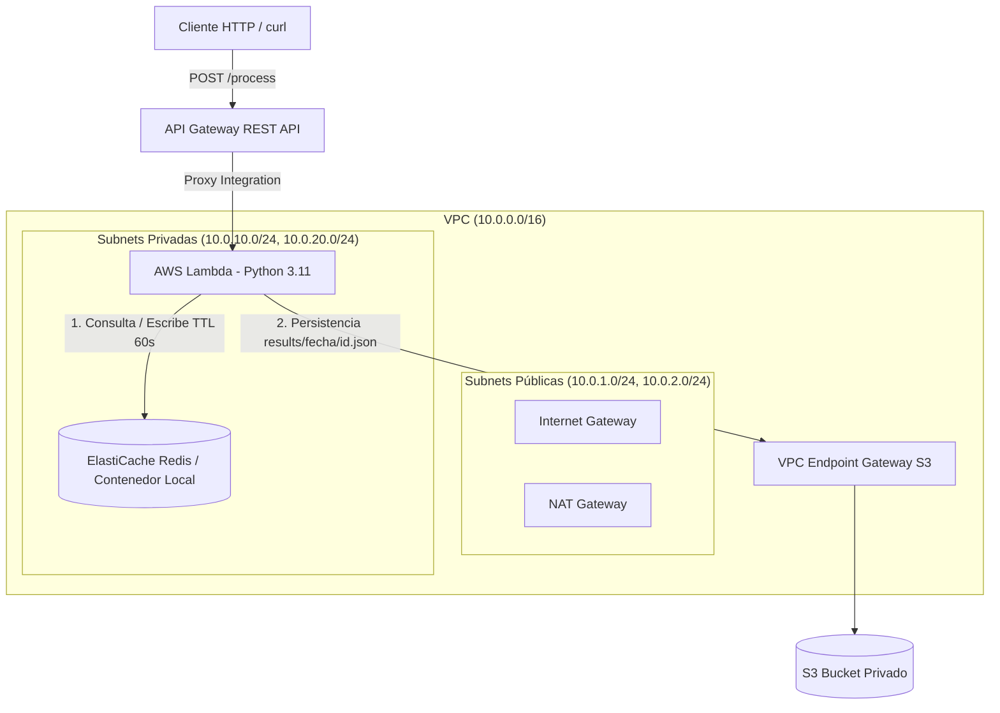

# Prueba Técnica SRE — Arquitectura Serverless en AWS con Terraform y LocalStack

Este repositorio contiene la implementación completa de la prueba técnica de Ingeniería SRE Junior. La solución despliega una arquitectura serverless desacoplada, segura y resiliente utilizando **Terraform (IaC)**, un endpoint HTTP en **API Gateway**, procesamiento en **AWS Lambda (Python 3.11)**, una capa de caché de alto rendimiento en **Redis** y persistencia privada en **AWS S3**.

---

## 1. Diagrama de Arquitectura



---

## 2. Estructura del Proyecto

```text
sre-prueba-tecnica/
├── .gitignore
├── README.md
├── main.tf
├── variables.tf
├── terraform.tfvars
├── lambda_function.py
└── evidence/
    ├── 01_request_miss.txt
    ├── 02_request_hit.txt
    └── 03_s3_ls.txt
```

---

## 3. Decisiones de Arquitectura y Patrones SRE

### A. API Gateway: REST API vs. HTTP API
Se seleccionó **API Gateway REST API** frente a HTTP API debido a sus capacidades nativas de control de tráfico a nivel de SRE:
* **Throttling & Rate Limiting:** Configurado en el Stage de producción con un límite de `rate_limit = 100` req/s y picos permitidos de `burst_limit = 200` req/s.
* **Proxy Integration (`AWS_PROXY`):** Pasa la petición limpia a la función Lambda manteniendo los encabezados HTTP y el cuerpo JSON sin transformar.

### B. AWS Lambda (Estrategia Zero-Dependencies)
* **Runtime:** Python 3.11.
* **Librería Socket Nativa:** Para la comunicación con Redis se implementó el protocolo RESP a través del módulo nativo `socket` de Python en lugar de paquetes externos (`redis-py`).
* **Ventajas SRE:**
  1. Reducción drástica del tiempo de **Cold Start** (artefacto ZIP < 5 KB).
  2. Eliminación de vulnerabilidades en la cadena de suministro de código (Supply Chain Attacks).
  3. Despliegue simplificado sin requerir pasos de compilar o empaquetar binarios C.

### C. Estrategia de Caché y Persistencia
* **Clave de Caché:** Generada a partir del campo `id` del cuerpo JSON recibido (`cache:<id>`).
* **TTL (Time to Live):** 60 segundos por registro para prevenir saturación de memoria.
* **Encabezado de Diagnóstico:** Cada respuesta HTTP incluye la cabecera personalizada `X-Cache: HIT` o `X-Cache: MISS` para observabilidad del cliente.
* **Ruta de Almacenamiento en S3:** `s3://<bucket_name>/results/YYYY-MM-DD/<id>.json`.

### D. Seguridad e Infraestructura como Código (IaC)
* **S3 Privado:** Configuración `aws_s3_bucket_public_access_block` con los 4 bloques activados (`block_public_acls = true`, etc.).
* **Versionamiento en S3:** Habilitado para protección de datos y recuperación ante fallos.
* **Principio de Mínimo Privilegio (IAM):** El rol de ejecución de Lambda solo posee permisos para `s3:PutObject` y `s3:GetObject` delimitados al prefijo `results/*`.
* **Seguridad de Red:** El tráfico entre la Lambda y S3 dentro de la VPC transita a través de un **VPC Endpoint tipo Gateway**, previniendo la salida a internet público.

---

## 4. Adaptaciones de Entorno: LocalStack Community vs. Producción AWS

Para garantizar la ejecución local al 100% de manera gratuita y sin requerir licencias de pago, se documentan las siguientes equivalencias técnicas entre el entorno local y la configuración para producción en AWS:

| Servicio | Entorno Local (LocalStack Free) | Entorno de Producción (AWS Real) |
| :--- | :--- | :--- |
| **Capa de Caché** | Contenedor Docker `redis:alpine` accesible vía `host.docker.internal:6379`. | AWS ElastiCache Cluster (`cache.t3.micro`) en subnets privadas. |
| **Red Lambda** | Ejecución directa en host simulando conectividad privada. | Configuración de `vpc_config` asignando ENIs en subnets privadas. |
| **Persistencia S3** | Endpoint HTTP LocalStack (`http://localhost:4566`). | Endpoint global de AWS S3 mediante VPC Gateway Endpoint. |

### Bloques de Código HCL para Despliegue en AWS Producción Real

#### 1. AWS ElastiCache Cluster
```hcl
resource "aws_elasticache_subnet_group" "redis_subnet_group" {
  name       = "sre-redis-subnet-group"
  subnet_ids = [aws_subnet.private_1.id, aws_subnet.private_2.id]
}

resource "aws_elasticache_cluster" "redis" {
  cluster_id           = "sre-redis-cluster"
  engine               = "redis"
  node_type            = "cache.t3.micro"
  num_cache_nodes      = 1
  parameter_group_name = "default.redis7"
  port                 = 6379
  subnet_group_name    = aws_elasticache_subnet_group.redis_subnet_group.name
  security_group_ids   = [aws_security_group.redis_sg.id]
}
```

#### 2. AWS Lambda con VPC Configured
```hcl
resource "aws_lambda_function" "process_function" {
  function_name    = "sre-process-payload"
  role             = aws_iam_role.lambda_role.arn
  handler          = "lambda_function.lambda_handler"
  runtime          = "python3.11"
  filename         = data.archive_file.lambda_zip.output_path
  source_code_hash = data.archive_file.lambda_zip.output_base64sha256

  vpc_config {
    subnet_ids         = [aws_subnet.private_1.id, aws_subnet.private_2.id]
    security_group_ids = [aws_security_group.lambda_sg.id]
  }

  environment {
    variables = {
      REDIS_HOST  = aws_elasticache_cluster.redis.cache_nodes[0].address
      REDIS_PORT  = "6379"
      BUCKET_NAME = aws_s3_bucket.private_bucket.id
    }
  }
}
```

---

## 5. Prerrequisitos

Asegúrate de contar con las siguientes herramientas instaladas en tu sistema local:

* **Terraform:** `>= 1.0.0`
* **Docker Desktop:** En ejecución.
* **LocalStack CLI:** Versión Community.
* **Python:** `3.11`
* **AWS CLI:** Configurado con credenciales mock (`AWS_ACCESS_KEY_ID=test`, `AWS_SECRET_ACCESS_KEY=test`, `AWS_DEFAULT_REGION=us-east-1`).

---

## 6. Guía de Despliegue Paso a Paso

### Paso 1: Iniciar el motor de caché en Docker
```powershell
docker run -d --name redis-local -p 6379:6379 redis:alpine
```

### Paso 2: Iniciar LocalStack
```powershell
localstack start -d
```

### Paso 3: Aprovisionar Infraestructura con Terraform
```powershell
terraform init
terraform plan
terraform apply -auto-approve
```

---

## 7. Verificación del Flujo End-to-End

### Petición 1: Fallo de Caché (CACHE MISS)
Ejecuta la primera solicitud enviando un payload en JSON:

```powershell
$API_ID = (terraform output -raw api_gateway_rest_api_id).Trim()
$URL = "http://localhost:4566/restapis/$API_ID/prod/_user_request_/process"
$BODY = '{"id": "101", "payload": "prueba-sre-despliegue"}'

curl.exe -i -X POST $URL -H "Content-Type: application/json" -d $BODY
```

**Resultado Esperado:**
* Código de respuesta: `200 OK`.
* Encabezado HTTP: `X-Cache: MISS`.
* La función consulta la fuente, escribe el resultado en Redis con TTL de 60s y guarda el objeto en S3.

### Petición 2: Acierto de Caché (CACHE HIT)
Ejecuta inmediatamente la misma solicitud antes de que expire el TTL de 60 segundos:

```powershell
curl.exe -i -X POST $URL -H "Content-Type: application/json" -d $BODY
```

**Resultado Esperado:**
* Código de respuesta: `200 OK`.
* Encabezado HTTP: `X-Cache: HIT`.
* La respuesta es entregada directamente desde la memoria de Redis sin recalcular.

### Verificación de Persistencia en el Bucket S3
Comprueba la existencia del archivo almacenado bajo la jerarquía de fecha:

```powershell
aws --endpoint-url=http://localhost:4566 s3 ls s3://sre-local-bucket-ei908k/results/ --recursive
```

---

## 8. Inventario de Evidencias (`evidence/`)

Los resultados de las pruebas ejecutadas fueron recolectados y almacenados en la carpeta `evidence/`:

* **`evidence/01_request_miss.txt`:** Muestra las cabeceras HTTP de respuesta y el cuerpo JSON correspondiente a la primera petición (`X-Cache: MISS`).
* **`evidence/02_request_hit.txt`:** Muestra las cabeceras HTTP de respuesta con la validación del acierto de caché (`X-Cache: HIT`).
* **`evidence/03_s3_ls.txt`:** Registro del comando AWS CLI listando el objeto JSON guardado en el bucket de S3 en la ruta `results/YYYY-MM-DD/101.json`.

---

## 9. Limpieza de Recursos

Para destruir la infraestructura provista y detener los contenedores locales:

```powershell
terraform destroy -auto-approve
docker stop redis-local
docker rm redis-local
```
